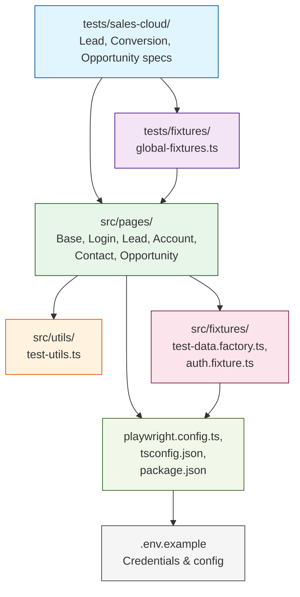

# Salesforce-Sales-Cloud-QA

**A professional TypeScript engineering project demonstrating Salesforce Sales Cloud QA automation with Playwright.**


Build an automated testing framework for Salesforce Sales Cloud that validates the complete Lead-to-Opportunity business process using Playwright and TypeScript. The framework tests actual Salesforce Lightning functionality using the Page Object Model (POM) pattern.

## 1. Project Overview

**Problem solved:** Salesforce Sales Cloud is a critical CRM system where the Lead-to-Opportunity business process directly impacts revenue. Manual testing of lead creation, conversion, and opportunity management is time-consuming, error-prone, and does not scale across releases.

**Why it is technically challenging:** Salesforce Lightning is a complex single-page application with dynamic component IDs, Shadow DOM, asynchronous rendering, and org-specific configurations. Selectors based on fixed IDs break frequently, and authentication (including MFA) must be handled securely.

**Proposed engineering solution:** A Playwright/TypeScript automation framework using the Page Object Model pattern with semantic selectors, environment-based credential management, unique synthetic test data, smoke/regression tagging, and comprehensive documentation including architecture, test plan, and requirements traceability matrix.

## 2. Key Features

- Page Object Model with BasePage and dedicated pages (Login, Lead, Account, Contact, Opportunity)
- 16 automated test scenarios covering Lead Management, Lead Conversion, and Opportunity Management
- Smoke (@smoke) and Regression (@regression) test tagging
- Unique synthetic test data generation to avoid duplicate record conflicts
- Secure credential management via environment variables (never committed)
- Two-factor authentication (TOTP) support via security token
- Playwright HTML reporting with traces, screenshots, and videos on failure
- Docker support for reproducible CI/CD execution
- GitHub Actions CI workflow
- TypeScript strict mode for type safety

## 3. System Architecture




Data flows from `.env` credentials through `AuthFixture` to `LoginPage`, then through business page objects (Lead, Account, Contact, Opportunity) with test data from factories. Tests assert business outcomes and produce Playwright HTML reports.

## 4. Technology Stack

| Technology | Purpose |
|------------|---------|
| TypeScript 5.6 | Core implementation with strict type checking |
| Node.js 18+ | Runtime environment |
| Playwright Test 1.48 | Test runner with auto-waiting, traces, screenshots |
| Chromium | Primary browser for test execution |
| Firefox / WebKit | Optional browser projects |
| ESLint + Prettier | Code quality and formatting |
| GitHub Actions | Continuous integration |
| Docker / docker-compose | Reproducible CI/CD environment |
| dotenv | Environment variable management |

## 5. Repository Structure

```
Salesforce-Sales-Cloud-QA/
├── README.md, LICENSE, CONTRIBUTING.md, CHANGELOG.md
├── package.json, tsconfig.json, playwright.config.ts
├── .env.example, .gitignore, .dockerignore
├── Dockerfile, docker-compose.yml
├── scripts/setup.sh, scripts/run_tests.sh
├── .github/workflows/ci.yml
├── src/
│   ├── pages/
│   │   ├── index.ts
│   │   ├── base.page.ts
│   │   ├── login.page.ts
│   │   ├── lead.page.ts
│   │   ├── account.page.ts
│   │   ├── contact.page.ts
│   │   └── opportunity.page.ts
│   ├── fixtures/
│   │   ├── auth.fixture.ts
│   │   └── test-data.factory.ts
│   └── utils/
│       └── test-utils.ts
├── tests/
│   ├── fixtures/
│   │   ├── global-fixtures.ts
│   │   └── index.ts
│   └── sales-cloud/
│       ├── lead-management/
│       │   └── lead-management.spec.ts
│       ├── lead-conversion/
│       │   └── lead-conversion.spec.ts
│       └── opportunity-management/
│           └── opportunity-management.spec.ts
├── docs/
│   ├── architecture.md
│   ├── design-decisions.md
│   ├── debugging-log.md
│   ├── security.md
│   ├── test-plan.md
│   ├── requirements-traceability-matrix.md
│   └── images/
└── screenshots/, test-results/, playwright-report/ (generated)
```

## 6. Installation and Setup

```bash
git clone https://github.com/yazanus94-dot/salesforce-sales-cloud-qa.git
cd salesforce-sales-cloud-qa
npm install
npx playwright install chromium
```

Copy `.env.example` to `.env` and fill in your Salesforce credentials:

```bash
cp .env.example .env
# Edit .env with your SF_USERNAME, SF_PASSWORD, SF_SECURITY_TOKEN
```

**Important:** Never commit `.env` with real credentials. It is gitignored.

Or use the setup script:

```bash
bash scripts/setup.sh
```

Or with Docker:

```bash
docker compose build
```

## 7. Execution

```bash
# Run all tests
npm test

# Run smoke tests only
npm run test:smoke

# Run regression tests only
npm run test:regression

# Run in UI mode
npm run test:ui

# View HTML report
npm run test:report

# Lint
npm run lint

# Format check
npm run format:check

# Type check
npm run types
```

Or with Docker:

```bash
docker compose up
docker compose down
```

**Expected outputs:** Playwright HTML report at `playwright-report/`, test results at `test-results/`, screenshots and traces on failure, videos on failure.

## 8. Testing and Verification

```bash
npm test
npm run lint
npm run types
```

**Test Categories:**

| Category | Tag | Description | Test Cases |
|----------|-----|-------------|------------|
| Smoke | `@smoke` | Critical path tests for fast feedback | TC-01, TC-02, TC-08, TC-12 |
| Regression | `@regression` | Comprehensive validation | TC-01 through TC-16 |

**Test Coverage (16 test cases):**

| Area | Test Cases | Description |
|------|-----------|-------------|
| Lead Management | TC-01 to TC-07 | Create, validate, search, update, refresh, duplicate handling |
| Lead Conversion | TC-08 to TC-11 | Convert leads, verify Account/Contact, verify converted status |
| Opportunity Management | TC-12 to TC-16 | Create, associate account, update stage, verify persistence, validation |

**Requirements Traceability:** 16 requirements, 16 test cases (100% coverage) — see `docs/requirements-traceability-matrix.md`.

**Note:** Live Salesforce execution requires valid credentials in `.env`. Without credentials, the framework structure and configuration are validated but live test execution is pending.

## 9. Performance Benchmarking

The framework is designed for efficient test execution:

- **Parallel execution:** Tests run fully parallel by default
- **Browser projects:** Chromium, Firefox, WebKit can run in parallel
- **Auto-waiting:** Playwright's auto-waiting eliminates unnecessary sleep/wait calls
- **Selective execution:** `--grep @smoke` or `--grep @regression` for targeted runs

**Benchmark dataset:** 16 test scenarios across 3 business processes  
**Baseline:** Manual testing of Lead-to-Opportunity process (~30 minutes)  
**Optimized:** Automated execution (~5-10 minutes)  
**Execution time:** Depends on Salesforce org response time  
**Memory consumption:** Minimal (Playwright browser context per worker)  
**Algorithmic complexity:** O(n) where n = number of test scenarios

**Reproducible measurements:** Run `npm test` and observe execution time in the Playwright report.

## 10. Debugging and Problem Resolution

Documented in full in `docs/debugging-log.md`. Highlights:

1. **Salesforce Lightning Dynamic Selectors** — Fixed IDs change on each page load. Fixed by using semantic selectors with multiple fallbacks.
2. **Page Load Timing Issues** — Salesforce Lightning loads asynchronously. Fixed with `waitForPageLoad()` and `safeClick`/`safeFill` wrappers.
3. **Duplicate Record Conflicts** — Salesforce rejects duplicate records. Fixed with unique synthetic test data generation.
4. **Two-Factor Authentication Prompts** — MFA prompts hang login flow. Fixed with graceful TOTP handling via security token.
5. **Convert Button Availability** — Convert button may be hidden by org config. Fixed with existence checks before conversion actions.

## 11. Design Decisions

Full rationale in `docs/design-decisions.md`. Key trade-offs:

- **Page Object Model** — Encapsulates UI selectors for maintainability when Salesforce updates its UI
- **Playwright Test Runner** — Auto-waiting, traces, screenshots, videos; better SPA support than Selenium
- **Environment-Based Configuration** — Credentials in `.env` (not committed); supports multiple org environments
- **Unique Synthetic Test Data** — Random suffixes prevent duplicate conflicts and enable parallel execution
- **Smoke vs Regression Tagging** — Selective execution for fast feedback vs comprehensive validation
- **No Live Execution Without Credentials** — Framework structure validated; live execution pending credentials
- **TypeScript Strict Mode** — Catches type errors at compile time

## 12. Security Considerations

Full details in `docs/security.md`. Key points:

- **No secrets in repository:** `.env` is gitignored; only `.env.example` is tracked
- **No hardcoded credentials:** All authentication via environment variables
- **No MFA bypass:** Two-factor authentication handled via official TOTP flow
- **No session theft:** Cookies and tokens never exported or logged
- **Synthetic data only:** No real customer data processed or stored
- **Headless mode in CI:** Prevents unintended browser interactions

## 13. Limitations

- Live Salesforce execution requires valid credentials (`SF_USERNAME`, `SF_PASSWORD`, `SF_SECURITY_TOKEN`)
- Salesforce org configuration may hide the Convert button or specific fields
- MFA enforcement varies by org; TOTP handling requires `SF_SECURITY_TOKEN`
- Salesforce session timeout may interrupt long test suites
- Test evidence screenshots pending live execution
- Framework tested against Salesforce Lightning; Classic UI not supported
- Research and education only — not a production Salesforce testing tool

## 14. Future Improvements

- Add API-based test data setup/teardown via Salesforce REST API
- Add visual regression testing with Playwright screenshot comparison
- Add performance metrics collection (page load times, response times)
- Add Slack/Email notifications for test failures
- Add test execution dashboard with historical trends
- Add support for Salesforce Communities and Experience Cloud sites
- Add mobile browser testing
- Add parallel execution across multiple Salesforce orgs

## 15. License

MIT License — see [LICENSE](LICENSE).