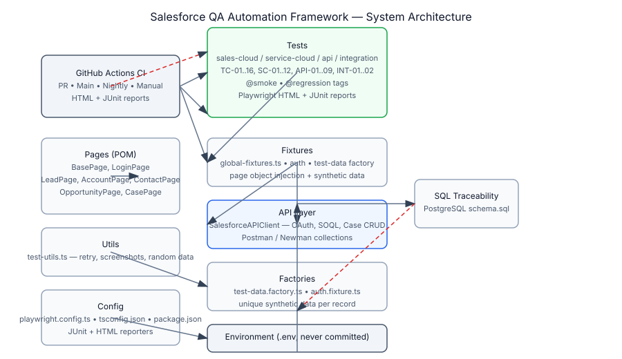
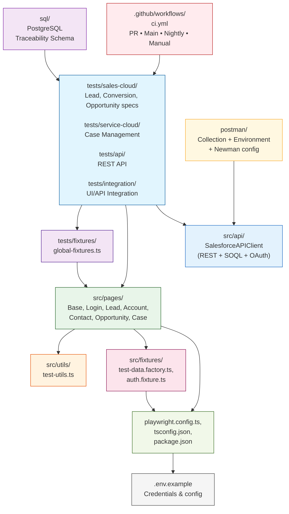

# Salesforce-Sales-Cloud-QA

**A professional TypeScript engineering project demonstrating Salesforce Sales Cloud and Service Cloud QA automation with Playwright.**


Build an automated testing framework for Salesforce Sales Cloud and Service Cloud that validates the complete Lead-to-Opportunity business process and Service Cloud Case Management using Playwright and TypeScript. The framework tests actual Salesforce Lightning functionality using the Page Object Model (POM) pattern.

**Project 1 — Sales Cloud QA Automation:** Lead Management, Lead Conversion, Opportunity Management.

**Project 2 — Service Cloud & API Automation Testing:** Case Management UI, Salesforce REST API (OAuth + SOQL + CRUD), UI/API integration, Postman/Newman collections, and PostgreSQL traceability schema.

**Project 3 — CI/CD Pipeline & Enterprise QA Automation:** GitHub Actions CI/CD (PR testing, main branch, nightly regression, manual dispatch), HTML + JUnit reporting, Jira QA templates, Git branching/PR workflow, and portfolio documentation.

---

## 1. Project Overview

**Problem solved:** Salesforce is a critical CRM system where Lead-to-Opportunity and Case Management processes directly impact revenue. Manual testing is time-consuming, error-prone, and does not scale across releases.

**Why it is technically challenging:** Salesforce Lightning is a complex single-page application with dynamic component IDs, Shadow DOM, asynchronous rendering, and org-specific configurations. Selectors based on fixed IDs break frequently, and authentication (including MFA) must be handled securely.

**Proposed engineering solution:** A Playwright/TypeScript automation framework using the Page Object Model pattern with semantic selectors, environment-based credential management, unique synthetic test data, smoke/regression tagging, and comprehensive documentation including architecture, test plan, CI/CD pipeline, Jira QA management, and requirements traceability.

---

## 2. Key Features

- **Page Object Model** with `BasePage` and dedicated pages (Login, Lead, Account, Contact, Opportunity, Case)
- **16 Sales Cloud automated test scenarios** covering Lead Management, Lead Conversion, and Opportunity Management (TC-01 to TC-16)
- **12 Service Cloud Case Management UI test scenarios** (SC-01 to SC-12)
- **9 Salesforce REST API test scenarios** (API-01 to API-09) with OAuth authentication and SOQL
- **2 UI/API integration test scenarios** (INT-01 to INT-02)
- **Smoke (`@smoke`) and Regression (`@regression`) test tagging** for selective execution
- **Unique synthetic test data generation** to avoid duplicate record conflicts
- **Secure credential management** via environment variables (never committed)
- **Two-factor authentication (TOTP) support** via security token
- **SalesforceAPIClient** for reusable REST API calls (authenticate, query, create, update, get)
- **Playwright HTML reporting** with traces, screenshots, and videos on failure
- **JUnit XML reporting** for CI integration and traceability
- **Docker support** for reproducible CI/CD execution
- **GitHub Actions CI workflow** with PR testing, main branch, nightly regression, and manual dispatch
- **TypeScript strict mode** for type safety
- **Postman collection + Newman config** for API smoke testing
- **PostgreSQL schema** for test traceability and execution results
- **Jira QA templates** (test case CSV, defect report template, traceability matrix)
- **Git workflow docs** (branch conventions, PR/issue templates, review checklists)

---

## 3. System Architecture





Data flows from `.env` credentials through `AuthFixture` to `LoginPage`, then through business page objects (Lead, Account, Contact, Opportunity, Case) with test data from factories. Tests assert business outcomes and produce Playwright HTML + JUnit reports. API tests use `SalesforceAPIClient` for OAuth-authenticated REST calls and SOQL queries. CI executes PR smoke tests, main-branch regression, nightly regression, and manual dispatch runs.

---

## 4. Technology Stack

| Technology | Purpose |
|------------|---------|
| TypeScript 5.6 | Core implementation with strict type checking |
| Node.js 18+ | Runtime environment |
| Playwright Test 1.48 | Test runner with auto-waiting, traces, screenshots |
| Chromium | Primary browser for test execution |
| Firefox / WebKit | Optional browser projects |
| ESLint + Prettier | Code quality and formatting |
| GitHub Actions | Continuous integration |
| Docker / docker-compose | Reproducible CI/CD environment |
| dotenv | Environment variable management |
| Salesforce REST API | Case CRUD, SOQL queries, OAuth 2.0 |
| Postman / Newman | API smoke test collection |
| PostgreSQL | Test traceability and execution results store |
| Jira | Test case management and defect tracking |

---

## 5. Repository Structure

```
Salesforce-Sales-Cloud-QA/
├── README.md, LICENSE, CONTRIBUTING.md, CHANGELOG.md
├── package.json, tsconfig.json, playwright.config.ts
├── .env.example, .gitignore, .dockerignore
├── .eslintrc.json
├── Dockerfile, docker-compose.yml
├── scripts/setup.sh, scripts/run_tests.sh
├── .github/
│   ├── workflows/ci.yml
│   └── templates/
│       ├── pull_request_template.md
│       ├── bug_report.md
│       ├── feature_request.md
│       └── test_case.md
├── src/
│   ├── pages/
│   │   ├── index.ts
│   │   ├── base.page.ts
│   │   ├── login.page.ts
│   │   ├── lead.page.ts
│   │   ├── account.page.ts
│   │   ├── contact.page.ts
│   │   ├── opportunity.page.ts
│   │   └── case.page.ts
│   ├── fixtures/
│   │   ├── auth.fixture.ts
│   │   └── test-data.factory.ts
│   ├── api/
│   │   ├── index.ts
│   │   └── salesforce-client.ts
│   └── utils/
│       └── test-utils.ts
├── tests/
│   ├── fixtures/
│   │   ├── global-fixtures.ts
│   │   └── index.ts
│   ├── sales-cloud/
│   │   ├── lead-management/lead-management.spec.ts
│   │   ├── lead-conversion/lead-conversion.spec.ts
│   │   └── opportunity-management/opportunity-management.spec.ts
│   ├── service-cloud/case-management.spec.ts
│   ├── api/rest-api.spec.ts
│   └── integration/ui-api-integration.spec.ts
├── postman/
│   ├── collections/Salesforce-Service-Cloud.postman_collection.json
│   ├── environments/Salesforce-Service-Cloud.postman_environment.json
│   └── newman-config.json
├── sql/schema.sql
├── docs/
│   ├── architecture.md
│   ├── design-decisions.md
│   ├── debugging-log.md
│   ├── security.md
│   ├── test-plan/
│   │   ├── test-plan.md
│   │   └── jira-qa-templates.md
│   ├── requirements-traceability-matrix.md
│   ├── git-workflow.md
│   └── images/
│       └── architecture.png
├── screenshots/, test-results/, playwright-report/ (generated)
└── junit.xml (generated in CI)
```

---

## 6. Installation and Setup

```bash
git clone https://github.com/yazanus94-dot/salesforce-sales-cloud-qa.git
cd salesforce-sales-cloud-qa
npm install
npx playwright install chromium
```

Copy `.env.example` to `.env` and fill in your Salesforce credentials:

```bash
cp .env.example .env
# Edit .env with your SF_USERNAME, SF_PASSWORD, SF_SECURITY_TOKEN
# For API tests also add: SF_CONNECTED_APP_CLIENT_ID, SF_CONNECTED_APP_CLIENT_SECRET
```

**Important:** Never commit `.env` with real credentials. It is gitignored.

Or use the setup script:

```bash
bash scripts/setup.sh
```

Or with Docker:

```bash
docker compose build
```

---

## 7. Execution

```bash
# Run all tests
npm test

# Run smoke tests only
npm run test:smoke

# Run regression tests only
npm run test:regression

# Run JUnit reporter (CI-friendly)
npm run test:junit

# Run Service Cloud UI tests
npx playwright test tests/service-cloud/

# Run REST API tests
npx playwright test tests/api/

# Run UI/API integration tests
npx playwright test tests/integration/

# Run in UI mode
npm run test:ui

# View HTML report
npm run test:report

# Lint
npm run lint

# Format check
npm run format:check

# Type check
npm run types

# Full verification pipeline
bash scripts/run_tests.sh
```

Or with Docker:

```bash
docker compose up
docker compose down
```

**Expected outputs:** Playwright HTML report at `playwright-report/`, test results at `test-results/`, JUnit XML at `junit.xml`, screenshots and traces on failure, videos on failure.

---

## 8. CI/CD Pipeline

The GitHub Actions workflow (`.github/workflows/ci.yml`) provides four execution modes:

| Workflow | Trigger | Purpose |
|----------|---------|---------|
| **PR Testing** | `pull_request` | Lint, type check, smoke tests; publish reports; block merge on failure |
| **Main Branch Testing** | `push` to `main` | Regression suite across Chromium + Firefox; HTML + JUnit reports |
| **Scheduled Regression** | `schedule` (nightly 02:00 UTC) | Full regression suite; artifacts retained 30 days |
| **Manual Execution** | `workflow_dispatch` | User-selects suite, browser, and environment |

### Required GitHub Secrets

| Secret | Purpose |
|--------|---------|
| `SF_BASE_URL` | Salesforce login URL |
| `SF_USERNAME` | Salesforce username |
| `SF_PASSWORD` | Salesforce password |
| `SF_SECURITY_TOKEN` | Salesforce security token (for TOTP) |
| `SF_CONNECTED_APP_CLIENT_ID` | Connected App client ID (API tests) |
| `SF_CONNECTED_APP_CLIENT_SECRET` | Connected App client secret (API tests) |

Never store real credentials in workflow files or commit them to the repository.

---

## 9. Testing and Verification

```bash
npm test
npm run lint
npm run types
npm run format:check
```

### Test Categories

| Category | Tag | Description | Test Cases |
|----------|-----|-------------|------------|
| Smoke | `@smoke` | Critical path tests for fast feedback | TC-01, TC-02, TC-08, TC-12, SC-01, SC-02, SC-10, INT-01 |
| Regression | `@regression` | Comprehensive validation | TC-01 through TC-16, SC-01 through SC-12, API-01 through API-09, INT-01 through INT-02 |

### Test Coverage

| Area | Test Cases | Description |
|------|-----------|-------------|
| Lead Management | TC-01 to TC-07 | Create, validate, search, update, refresh, duplicate handling |
| Lead Conversion | TC-08 to TC-11 | Convert leads, verify Account/Contact, verify converted status |
| Opportunity Management | TC-12 to TC-16 | Create, associate account, update stage, verify persistence, validation |
| Service Cloud Case Management | SC-01 to SC-12 | Create, validate mandatory fields, update, priority, assign, status, close, reopen, search, persistence, access |
| Salesforce REST API | API-01 to API-09 | OAuth auth, Case CRUD, SOQL, response validation, invalid requests |
| UI/API Integration | INT-01 to INT-02 | Create via API→SOQL→update→confirm in UI; Create via UI→verify via API |

**Requirements Traceability:** 16 Sales Cloud + 12 Service Cloud + 9 API + 2 Integration = 39 test cases — see `docs/requirements-traceability-matrix.md`.

**Note:** Live Salesforce execution requires valid credentials in `.env`. Without credentials, the framework structure and configuration are validated but live test execution is pending.

---

## 10. Performance Benchmarking

The framework is designed for efficient test execution:

- **Parallel execution:** Tests run fully parallel by default
- **Browser projects:** Chromium, Firefox, WebKit can run in parallel
- **Auto-waiting:** Playwright's auto-waiting eliminates unnecessary sleep/wait calls
- **Selective execution:** `--grep @smoke` or `--grep @regression` for targeted runs

**Benchmark dataset:** 39 test scenarios across 5 business processes  
**Baseline:** Manual testing of Lead-to-Opportunity and Case Management (~45 minutes)  
**Optimized:** Automated execution (~10-15 minutes)  
**Execution time:** Depends on Salesforce org response time  
**Memory consumption:** Minimal (Playwright browser context per worker)  
**Algorithmic complexity:** O(n) where n = number of test scenarios  

**Reproducible measurements:** Run `npm test` and observe execution time in the Playwright report.

---

## 11. Debugging and Problem Resolution

Documented in full in `docs/debugging-log.md`. Highlights:

1. **Salesforce Lightning Dynamic Selectors** — Fixed IDs change on each page load. Fixed by using semantic selectors with multiple fallbacks.
2. **Page Load Timing Issues** — Salesforce Lightning loads asynchronously. Fixed with `waitForPageLoad()` and `safeClick`/`safeFill` wrappers.
3. **Duplicate Record Conflicts** — Salesforce rejects duplicate records. Fixed with unique synthetic test data generation.
4. **Two-Factor Authentication Prompts** — MFA prompts hang login flow. Fixed with graceful TOTP handling via security token.
5. **Convert Button Availability** — Convert button may be hidden by org config. Fixed with existence checks before conversion actions.
6. **Case Page Dynamic Selectors** — Case management in Service Cloud uses dynamic selectors. Fixed with same semantic selector patterns as Sales Cloud pages.
7. **API Authentication** — OAuth 2.0 username-password flow requires Connected App credentials. Fixed via `SalesforceAPIClient.authenticate()` with env vars.

---

## 12. Design Decisions

Full rationale in `docs/design-decisions.md`. Key trade-offs:

- **Page Object Model** — Encapsulates UI selectors for maintainability when Salesforce updates its UI
- **Playwright Test Runner** — Auto-waiting, traces, screenshots, videos; better SPA support than Selenium
- **Environment-Based Configuration** — Credentials in `.env` (not committed); supports multiple org environments
- **Unique Synthetic Test Data** — Random suffixes prevent duplicate conflicts and enable parallel execution
- **Smoke vs Regression Tagging** — Selective execution for fast feedback vs comprehensive validation
- **No Live Execution Without Credentials** — Framework structure validated; live execution pending credentials
- **TypeScript Strict Mode** — Catches type errors at compile time
- **SalesforceAPIClient** — Reusable REST API client encapsulating OAuth, Case CRUD, and SOQL
- **Postman/Newman** — Separate API smoke test collection for non-Playwright execution

---

## 13. Security Considerations

Full details in `docs/security.md`. Key points:

- **No secrets in repository:** `.env` is gitignored; only `.env.example` is tracked
- **No hardcoded credentials:** All authentication via environment variables
- **No MFA bypass:** Two-factor authentication handled via official TOTP flow
- **No session theft:** Cookies and tokens never exported or logged
- **Synthetic data only:** No real customer data processed or stored
- **Headless mode in CI:** Prevents unintended browser interactions
- **CI credentials via GitHub Secrets:** Never plaintext in workflow files

---

## 14. Jira QA Management

Professional QA management documentation in `docs/test-plan/jira-qa-templates.md`:

- **Test case template** (`test-case-template.csv`) — Jira-ready CSV for test case creation/import
- **Example test cases** (`example-test-cases.csv`) — 39 records covering all automated scenarios
- **Defect report template** (`defect-report-template.md`) — severity/priority classification, steps to reproduce, expected vs actual, evidence
- **Severity & priority classification guide** — Critical/High/Medium/Low and P0/P1/P2/P3
- **Requirements-to-test traceability** — see `docs/requirements-traceability-matrix.md`

---

## 15. Git & Collaboration Workflow

Documented in `docs/git-workflow.md`:

- **Branching strategy:** `main` + `develop` with feature/bugfix/release/hotfix branches
- **Commit guidelines:** Conventional commits with scope examples
- **Pull request process:** PR template, checklist, squash-merge, reviewer requirements
- **Issue templates:** Bug report, feature request, test case
- **Code review checklist** and **test review checklist**
- **README contribution instructions**

---

## 16. Limitations

- Live Salesforce execution requires valid credentials (`SF_USERNAME`, `SF_PASSWORD`, `SF_SECURITY_TOKEN`)
- API tests require Connected App OAuth credentials (`SF_CONNECTED_APP_CLIENT_ID`, `SF_CONNECTED_APP_CLIENT_SECRET`)
- Salesforce org configuration may hide the Convert button or specific fields
- MFA enforcement varies by org; TOTP handling requires `SF_SECURITY_TOKEN`
- Salesforce session timeout may interrupt long test suites
- Test evidence screenshots pending live execution
- Framework tested against Salesforce Lightning; Classic UI not supported
- Research and education only — not a production Salesforce testing tool

---

## 17. Future Improvements

- Add API-based test data setup/teardown via Salesforce REST API
- Add visual regression testing with Playwright screenshot comparison
- Add performance metrics collection (page load times, response times)
- Add Slack/Email notifications for test failures
- Add test execution dashboard with historical trends
- Add support for Salesforce Communities and Experience Cloud sites
- Add mobile browser testing
- Add parallel execution across multiple Salesforce orgs
- Add API test data fixtures for UI test preconditions

---

## 18. License

MIT License — see [LICENSE](LICENSE).

---

## 19. Portfolio Demonstration Guide

This project is designed as a portfolio-ready QA automation demonstration. To present it:

1. **Clone and install:** `git clone`, `npm install`, `npx playwright install chromium`.
2. **Review structure:** Walk through `src/pages/` (POM), `src/fixtures/` (data/auth), `src/api/` (REST client), `tests/` (specs by business process).
3. **Run verification:** `npm run types`, `npm run lint`, `npm run test:smoke` (structure validated without live credentials).
4. **Review CI:** Open `.github/workflows/ci.yml` to show PR, main, nightly, and manual pipeline modes.
5. **Review documentation:** `docs/architecture.md`, `docs/debugging-log.md`, `docs/git-workflow.md`, `docs/test-plan/jira-qa-templates.md`, `docs/requirements-traceability-matrix.md`.
