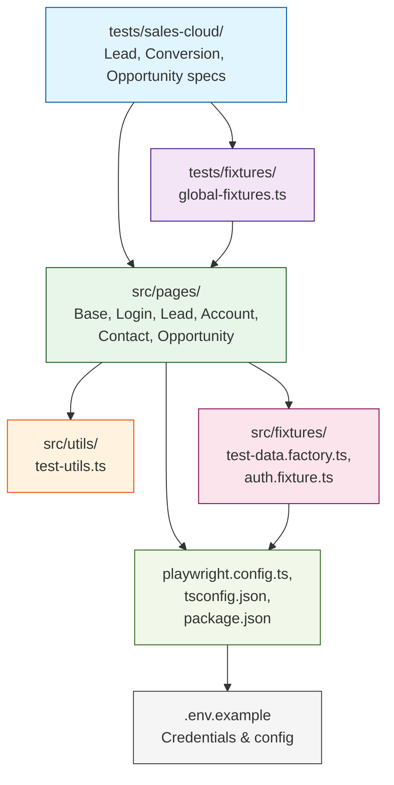

# Architecture

## Overview

Salesforce Sales Cloud QA Automation Framework is a Playwright/TypeScript
automation framework that validates the complete Lead-to-Opportunity business
process in Salesforce Sales Cloud using the Page Object Model (POM) pattern.

## Architecture Diagram

## Layer Overview

| Layer | Responsibility |
|-------|---------------|
| **Tests** | Test scenarios grouped by business process (Lead Mgmt, Lead Conversion, Opportunity Mgmt) |
| **Fixtures** | Auth fixtures, page object injection, test data factories |
| **Pages** | Page Object Model - encapsulates Salesforce Lightning UI interactions |
| **Utils** | Shared helpers - retry, random data, date formatting, screenshots |
| **Config** | Playwright config, TypeScript config, npm scripts |

## Test Execution Flow

1. **AuthFixture** logs into Salesforce using `SF_USERNAME`/`SF_PASSWORD` from `.env`
2. **Page Objects** navigate to the relevant tab (Leads, Accounts, Contacts, Opportunities)
3. **Test Data Factories** generate unique synthetic data to avoid duplicates
4. **Assertions** validate expected business outcomes
5. **Playwright** captures screenshots, traces, and videos on failure

## Security Boundaries

- Credentials are stored only in `.env` (never committed)
- `.env.example` provides template without real values
- No MFA bypass or authentication control circumvention
- No hardcoded secrets in source code
